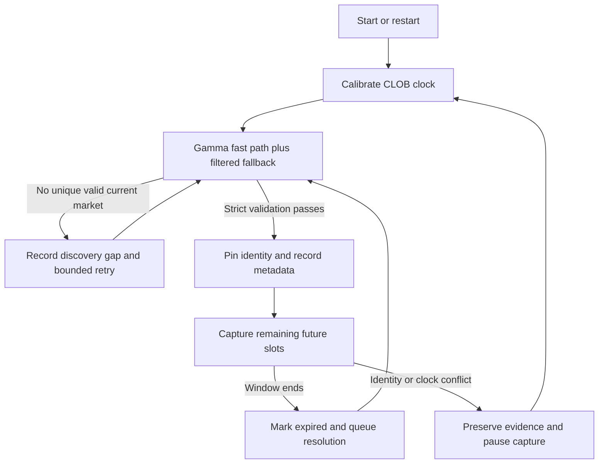
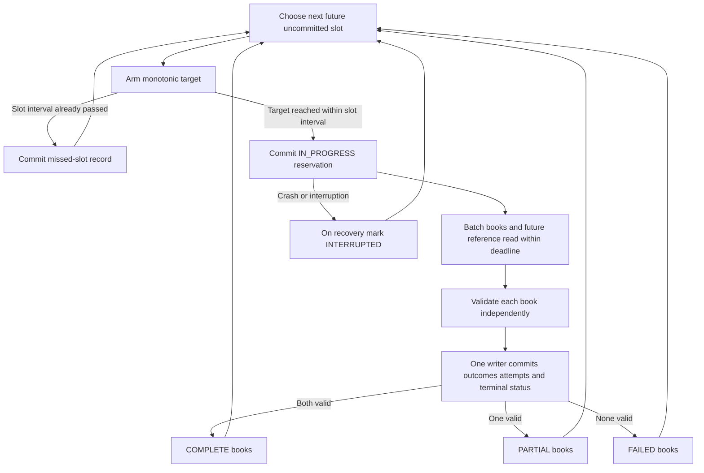
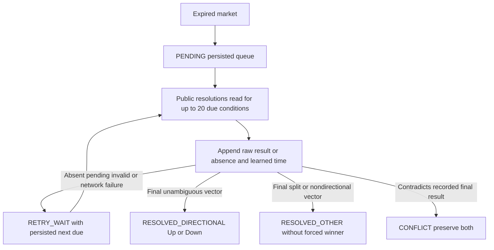
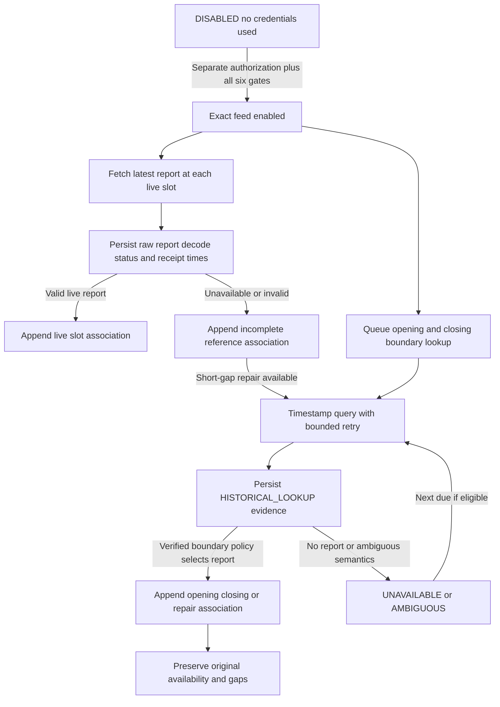

# BTC 15-minute market-data recorder design

Date: 2026-10-10 (Asia/Jakarta)

Status: Written specification awaiting user review. The conversational
architecture and the user's final amendments are approved. This document
requires separate approval before an implementation plan is written.

## 1. Purpose, authority and completion boundaries

Build a local Python data recorder for future replay, backtesting and paper
trading research. Collect from now onward: validated Polymarket BTC 15-minute
Up/Down market metadata, full returned outcome books, timing and quality
evidence, and eventual resolution. Design the exact Chainlink BTC/USD
60-second TWAP domain now, without assuming historical recovery will be safe.

The user's final decisions are binding. This specification extends milestone
1 for the recorder only. Its existing one-shot snapshot CLI, token mapping,
strict discovery and book validation remain compatible. Its GET-only policy
is extended narrowly for the recorder's public `POST /books` read; its
120-second snapshot deadline is not reused as a sampling deadline.

Two different kinds of completeness must never be confused:

- Book completeness: both independently validated books were received within
  an observation's collection budget. Empty bid/ask sides are valid empty
  books, not transport failures or invented prices.
- Reference completeness: the correct feed, decoding and boundary semantics
  have passed the activation gate; live reference coverage and verified
  opening/closing associations are present for the research interval.

Neither label promises every intervening price change, passive-order queue
position, fills, or suitability for arbitrary future strategies. Sampled
reference completeness is limited to the stated two-second research cadence.

An explicitly authorized future engineering pilot without reference collection
must display and persist both labels `BOOK_ONLY` and `REFERENCE_INCOMPLETE`.
It must not be advertised as strategy-complete. An empty reference schema or
a later successful backfill does not convert its original live coverage into
complete coverage.

## 2. Scope and authorization gates

In scope for the design:

- SQLite persistence with exactly one writer and crash/restart recovery.
- Full returned Up/Down book evidence and indexed quote summaries.
- Two-second slots aligned to each validated 900-second window.
- Explicit partial observations, missed slots and rollover gaps.
- Persistent, independent resolution reconciliation.
- Reference feed/report/fetch/association domains and a future direct Chainlink
  REST collector; exact feed authentication is an architectural requirement.
- Storage, latency, coverage and reconciliation measurements.
- Offline behavioral tests and separately authorized engineering checks.

Excluded: historical market import, trading wallets/private keys, trading
credentials, Polymarket authentication, order creation/cancellation, strategy,
signals, position sizing, balances, simulated trades, real money, public trade
collection, WebSockets, secondary BTC spot feeds, dashboards, database servers,
cloud services, automatic cadence changes and unrelated refactoring.

This document creates no application, database, accounts, secrets, subscriptions
or dependencies. Implementation requires written-spec approval followed by
review of the implementation plan and an execution choice.

Future implementation may provide dormant, offline-tested Chainlink interfaces
and decoding support. Runtime authentication is disabled until separately
authorized. Long-term reference-dependent recording must refuse to start
unless all of the following are recorded as verified:

1. Entitlement to the exact mainnet TWAP feed.
2. Actual subscription price and subscription decision.
3. Credential availability and explicit permission to enable their use.
4. Successful authenticated retrieval for that feed.
5. Correct schema, exact numeric scaling and report decoding.
6. Opening/closing boundary-report behavior applicable to Polymarket.

No wallet is required for direct offchain Chainlink report retrieval. No
Polymarket credential path is introduced as a shortcut. A book-only pilot is
a separate later authorization, not permission granted by this specification.

## 3. Evidence, official contracts and unresolved gates

Research checked on 2026-10-10:

| Official source | Contract used |
| --- | --- |
| [Polymarket discovery](https://docs.polymarket.com/market-data/discover-markets) | Gamma discovery/metadata; preserve milestone-1 fallback and validation |
| [Single book](https://docs.polymarket.com/api-reference/market-data/get-order-book) | Public token book, levels and identity |
| [Batch books](https://docs.polymarket.com/api-reference/market-data/get-order-books-request-body) | Public `POST /books` with token-ID request body |
| [Prices and books](https://docs.polymarket.com/market-data/prices-order-books) | Public batch usage and book semantics |
| [CLOB configuration](https://docs.polymarket.com/api-reference/markets/get-clob-market-info) | Tokens, fee settings, tick/minimum-size metadata |
| [Resolution](https://docs.polymarket.com/concepts/resolution) | Opening TWAP and closing TWAP comparison; equality means Up |
| [Resolution state](https://docs.polymarket.com/api-reference/markets/get-resolution-state) | Data API `/v2/resolutions`, raw status/payouts/time |
| [Polymarket limits](https://docs.polymarket.com/api-reference/rate-limits) | Shared-IP throttling and delayed requests |
| [Chainlink directory](https://docs.chain.link/data-streams/crypto-streams) | Mainnet TWAP product/feed identity |
| [Chainlink report API](https://docs.chain.link/data-streams/reference/data-streams-api/interface-api) | Latest, timestamp and sequential report reads |
| [Chainlink TWAP schema](https://docs.chain.link/data-streams/reference/report-schema-v2) | Signed report fields; TWAP price rather than spot price |
| [Chainlink timestamps](https://docs.chain.link/data-streams/how-report-timestamps-work) | Second-precision validity intervals, variable intervals and delayed delivery |
| [Chainlink authentication](https://docs.chain.link/data-streams/reference/data-streams-api/authentication) | Username/identifier, HMAC secret, signed requests and feed permissions |
| [Chainlink subscription guide](https://docs.chain.link/data-streams/sign-up) | Paid access, no free tier; individual feeds starting at $150/month |
| [Chainlink limits](https://docs.chain.link/data-streams/rate-limits) | Subscription limits; WebSocket preferred for report delivery |
| [Polymarket reference-feed migration](https://docs.polymarket.com/migrate/rtds-to-polybolt) | Deprecated public RTDS topics; authenticated TWAP replacement excluded here |
| [Python SQLite](https://docs.python.org/3.12/library/sqlite3.html) | Built-in local database support |
| [SQLite atomic commit](https://www.sqlite.org/atomiccommit.html) | Transactional recovery within filesystem/hardware guarantees |

Live evidence is supporting evidence, not a permanent contract:

- Current Gamma rules pointed to
  `https://data.chain.link/streams/btc-usd-twap-60s-streams`.
- Official Chainlink directory HTML metadata listed
  `BTC/USD-Streams-TWAP-60s-mainnet-production`, product
  `BTC/USD-Streams-TWAP-60s-DS-Premium-Global-002`, status `live`, schema v2,
  feed ID `0x0002ee6757e8822c00d273bc340fc24c9cafe123a4ff2ea1dbdb31944bc7d95f`.
  The unauthenticated filtered Discovery response omitted that TWAP entry.
- Public batch reads returned both requested Gamma `clobTokenIds` with the
  selected condition. One comparison measured 217 ms for batch versus 441 ms
  for two sequential GETs, with source-time differences of 0 ms and 213 ms.
  Neither this measurement nor equal source timestamps proves atomicity.
- A resolved market returned `status=resolved`, payouts `[1000000, 0]` and a
  reported resolution timestamp. Payout scale is not hard-coded to one.
- An expired market still reported open/accepting flags before final resolution.

Historical timestamp/page retrieval is officially documented in general. No
retention duration, exact-feed historical coverage guarantee, exact-feed price,
entitlement or successful authenticated report read was established. Decision
B is binding: do not depend on later backfill for long-term data completeness.
The report's `expiresAt` concerns report validity, not a history-retention SLA.

Exact report scaling and Polymarket's boundary report-selection behavior remain
activation gates, not guessed constants. In particular, directory fields or
legacy RTDS E18 conversion do not authorize an assumed TWAP decoder scale.
Polymarket/Chainlink documentation also differs on some taker-delay descriptions;
retain observed fee/delay configuration without implementing fill assumptions.

## 4. API surface and component boundaries

| Component | Responsibility and dependencies |
| --- | --- |
| Recorder coordinator | Owns lifecycle, scheduling and shutdown; calls focused adapters and the writer |
| Discovery/metadata adapter | Reuses Gamma fast path, filtered fallback and strict current-window validation; retrieves revisions |
| Book adapter | Batch by default; independent token/condition validation and bounded single-book fallback |
| Slot scheduler and clock | Window-aligned slot identities; injected monotonic clock plus recorded CLOB time calibration |
| Resolution reconciler | Independently manages pending expired markets and public resolution reads |
| Future reference collector/reconciler | Exact-feed reads, decoding, original availability evidence and boundary associations; dormant by default |
| SQLite store | One connection owner/writer, short transactions, uniqueness and recovery |
| Measurements | Reads ledger/attempts/checkpoints and reports fixed-cadence quality/storage statistics |

Use the existing Python/httpx foundation and standard-library SQLite,
compression, hashing, Decimal, clocks and tests. Do not build an ORM, generic
HTTP framework, plugin system or event bus. Specific data adapters communicate
with plain records. There is no trade-capable client in a recorder record.

Permitted public requests:

- Gamma host `https://gamma-api.polymarket.com`: existing `GET /events`,
  `GET /events/slug/{slug}`, `GET /markets/{id}`.
- CLOB host `https://clob.polymarket.com`: `GET /time`, `GET /book`,
  `GET /clob-markets/{condition_id}`, and the single named `POST /books` read.
- Data host `https://data-api.polymarket.com`: `GET /v2/resolutions` using
  the documented `condition` selector, up to 20 condition IDs per request.

`POST /books` accepts only a body constructed internally from the two validated
token IDs. There is no caller-supplied method, URL, arbitrary body or generic
POST function. Unknown hosts/paths and redirects are rejected. All other POST,
DELETE and authenticated Polymarket requests remain forbidden. The old snapshot
CLI can continue using individual GETs.

Future, separately enabled Chainlink reads are limited to
`https://api.dataengine.chain.link/api/v1/reports/latest`, `/api/v1/reports`,
and `/api/v1/reports/page` for the pinned approved feed. Their authentication
belongs in a separate data-only adapter. Never persist/log credentials, signed
authorization headers or secret-bearing debug strings. No account creation,
purchase, key generation or onchain verification transaction is part of it.

## 5. Discovery, clocks and window scheduling

Keep milestone-1 discovery: timestamp-slug fast path, independently usable
Gamma filtered-list fallback, bounded enumeration, unique selection, exact
900-second metadata duration and conservative BTC/Up/Down recognition. Never
substitute a future or expired market. Preserve original outcome-array indices
alongside exact `clobTokenIds`; no protocol identifier branching is introduced.

Cache the validated market within its window; do not run the one-shot CLI or
repeat full discovery at every slot. Refresh operational metadata/configuration
at acquisition and approximately every 60 seconds if the housekeeping budget
permits. Revisions retain first-observed times; failed refreshes retain an age
warning rather than pretending old metadata is newly observed.

At startup obtain CLOB server time, anchor it to the monotonic request midpoint,
and retain raw Unix seconds, RTT and a conservative uncertainty of one second
plus half the RTT. Refresh about every 60 seconds and before a boundary when
possible. An anchor older than 120 seconds is unusable for capture until a new
one succeeds. This is a recorder policy, not a CLOB guarantee.

All `_us` timestamps below are integer UTC microseconds; `_mono_ns` readings
and durations are integer nanoseconds. Monotonic values are comparable only
within a run. Record local wall UTC separately from estimated server UTC.
Do not adjust the Windows clock or rewrite historical timestamps after a new
calibration. An anchor shift exceeding the combined uncertainty bounds plus
one second triggers a recorded clock-discontinuity pause, fresh calibration
and current-market validation. Slot IDs stay unchanged; never replay a past
slot to compensate for a clock shift.

For every selected market:

```text
slot_index = 0..449
scheduled_at = window_start + slot_index * 2 seconds
```

The last scheduled slot is +898 seconds; +900 belongs to the next market.
Map future UTC targets to monotonic deadlines using the active clock anchor.
Sleep until an armed future slot, not for two seconds after processing finishes.

At startup/restart choose the first future uncommitted slot. Classify earlier
slots as `MISSED` with reason `BEFORE_START` or `DOWNTIME`; do not fetch them.
An armed slot may wake late: preserve lateness, and collect at most that one
slot if its next scheduled boundary has not passed. If it has passed, mark it
and intervening expired slots missed, then arm the next future slot. After
processing, any passed unstarted slot is missed, even if only slightly late.
Never issue catch-up bursts.

The network collection deadline is the earlier of scheduled time +2 seconds
and market end, converted to monotonic time. Clamp all request/retry timeouts
to remaining budget. A response delivered after it is retained only as late
evidence, not a usable quote. Short SQLite commits may finish later; record
commit timing separately and skip any subsequent slot whose target passed.

## 6. Book reads, pricing and transaction contents

Prefer one batch request for both tokens. Match by returned `asset_id`, never
array position: live responses can reorder outcomes. Each matching element
must have the requested token ID AND selected condition ID and pass existing
level/time validation. A missing element fails that outcome; duplicated matching
elements are ambiguous and fail it. Unexpected elements produce a diagnostic
and are never attached to an outcome. Preserve bounded raw diagnostic evidence.

Fallback is justified only for batch route unavailability (`404`/`405`) or a
successful batch missing a requested token. Use individual GETs for the affected
outcomes within the same slot budget. Do not fallback to evade throttling,
retry identity mismatches as if they were availability failures, or mask a
malformed batch schema. Other retryable failures receive at most one bounded
retry; respect Retry-After if it fits, otherwise record failure and continue
at the next slot. Never extend a slot because fallback has more work to do.

Use bounded response streaming with the existing 10 MiB decoded-body ceiling;
response-size failures are explicit. HTTP phase timeouts alone are insufficient:
check the monotonic deadline while reading and parsing, reject late results,
and account for blocking phase overshoot in quality data.

Keep existing strict Decimal validation, extrema over all positive-size levels,
top-price size sums and crossed-book rejection. Empty sides are valid with
nullable quotes. Midpoint/spread require both sides; Gamma prices, opposite
outcome complements, zero and last trades never fill missing quotes.
Preserve input Decimal digits; arithmetic precision must accommodate the input
digits and level aggregation without relying on the default Decimal precision
to round away source evidence.

Save each returned book's own source timestamp, raw timestamp, hash, identity,
request interval and original complete level payload. Batch outcomes share
their HTTP attempt interval and point to one stored original batch-response
body, preserving full depth without reconstructing or duplicating JSON elements.
Individual GET responses are likewise stored once per attempt. Outcomes keep
independent source times. A data warning
always states that the batch is not guaranteed atomic, even when times match.
Old source timestamps may mean unchanged books; retain source age separately
from fetch freshness. Mark times more than five seconds beyond the calibrated
receipt time plus uncertainty as incompatible; age thresholds are quality
flags, not manufactured fresh values or proof of executable liquidity.

No request starts for an old market after its window ends. Evidence received
late/across expiry is flagged and cannot be used as an in-window quote. Valid
partial evidence remains tied to its old condition; never mix it with the new
market or discard it merely because the other outcome failed.

Reserve a slot using a short transaction before network work. Then atomically
finalize the slot, both outcome result rows (including explicit failures),
attempt timing and available reference association. Do not hold a SQLite
transaction open during network I/O. Already finished work lost before commit
cannot be recovered from memory after a crash; it becomes interrupted coverage.

`COMPLETE` means two usable validated books, `PARTIAL` one, `FAILED` none.
`MISSED` means no acquisition was started; `INTERRUPTED` means reserved work
was interrupted before terminal commit. `IN_PROGRESS` is a reservation only.
Reference status is independent and cannot change those book-success counts.

## 7. Explicit SQLite schema (version 1)

Use one local `data/recorder.sqlite3`, already covered by the project's data
ignore rule. Enable foreign keys, rollback-journal mode and synchronous FULL.
Use one writer/connection owner; only short transactions. WAL, competing writer
processes, automatic file rotation and automatic retention deletion are omitted.
Concurrent readers must be short-lived and must not starve acquisition.

Notation: `PK` primary key; `FK` foreign key; `?` nullable. IDs/tokens are TEXT
unless explicitly integer row IDs. UTC `_us`/monotonic `_ns` values and counts
are INTEGER. Exact prices/sizes are canonical finite decimal TEXT validated
by Python, never SQLite REAL. JSON is UTF-8 TEXT unless the column ends `_z`:
those columns are BLOB containing zlib-compressed original response/report
bytes, with codec version and uncompressed byte count. Preserve originals
before normalization; decompression is bounded to the stored body-size ceiling.

Schema version is SQLite `user_version=1`. A different unknown version must
fail startup rather than silently migrate or overwrite evidence.

### 7.1 `recording_runs`

| Columns | Type / rule |
| --- | --- |
| `run_id` | TEXT PK, generated UUID |
| `started_wall_us`, `ended_wall_us` | INTEGER, end nullable |
| `mode` | TEXT: `BOOK_ONLY` or `REFERENCE_REQUIRED` |
| `reference_activation` | TEXT: `DISABLED` or `VERIFIED`; VERIFIED requires gate evidence |
| `state` | TEXT: `RUNNING`, `STOPPED`, `FAILED`, `INTERRUPTED` |
| `app_revision`, `config_json`, `activation_evidence_json` | TEXT; evidence nullable when disabled; secrets excluded |
| `last_committed_wall_us`, `exit_reason` | INTEGER? / TEXT? |

Run mode is immutable. `REFERENCE_REQUIRED` cannot start under DISABLED.
Config records fixed cadence, timeout/quality policies and decoder revision.

### 7.2 `clock_anchors`

| Columns | Type / rule |
| --- | --- |
| `anchor_id` | INTEGER PK |
| `run_id` | TEXT FK recording_runs |
| `server_seconds`, `request_start_mono_ns`, `request_end_mono_ns` | INTEGER |
| `request_start_wall_us`, `request_end_wall_us` | INTEGER |
| `anchor_mono_ns`, `anchor_server_us`, `uncertainty_us` | INTEGER |
| `status`, `diagnostic_json` | TEXT; VALID or DISCONTINUITY; optional diagnostic |

Append only. Index `(run_id, anchor_mono_ns)`. Network failures are recorded in
request attempts/events, not fabricated valid anchors.

### 7.3 `markets`

| Columns | Type / rule |
| --- | --- |
| `market_id` | TEXT PK, Gamma ID |
| `event_id`, `condition_id`, `slug`, `question` | TEXT; condition UNIQUE |
| `window_start_us`, `window_end_us`, `first_seen_us` | INTEGER; end-start exactly 900,000,000 |
| `up_token_id`, `down_token_id` | TEXT, distinct |
| `up_outcome_index`, `down_outcome_index` | INTEGER; distinct members of {0,1} |
| `lifecycle` | TEXT: CURRENT, EXPIRED, or INVALIDATED |
| `resolution_state` | TEXT: PENDING, RETRY_WAIT, RESOLVED_DIRECTIONAL, RESOLVED_OTHER, CONFLICT |
| `resolution_next_due_us`, `resolution_attempts` | INTEGER? / INTEGER nonnegative |
| `selected_resolution_id` | INTEGER? FK resolution_observations |

Immutable identity/window/token mapping. Contradictory later metadata is
diagnostic evidence and invalidates acquisition, never rewrites the identity.
Index `(window_start_us)` and `(resolution_state, resolution_next_due_us)`.
The queue is these fields, not another writer or generic job service.

### 7.4 `market_revisions`

| Columns | Type / rule |
| --- | --- |
| `revision_id`, `market_id` | INTEGER PK / TEXT FK markets |
| `observed_us`, `run_id` | INTEGER / TEXT FK recording_runs |
| `description`, `resolution_source_url` | TEXT; save actual market rules/source |
| `active`, `closed`, `accepting_orders`, `enable_order_book` | INTEGER? booleans |
| `fee_config_json`, `tick_size_text`, `min_order_size_text`, `delay_config_json` | TEXT?; data only |
| `gamma_raw_z`, `clob_config_raw_z`, `raw_sizes_json`, `codec_version` | BLOB / BLOB? / TEXT / INTEGER |
| `content_hash` | TEXT |

Append changed metadata; index `(market_id, observed_us)`. Operational ages
use latest successful refresh attempts, even if content is unchanged. Original
outcome arrays and optional Gamma prices/identifier fields remain in raw
metadata and never replace the pinned mapping or executable quote source.

### 7.5 `sample_slots`

| Columns | Type / rule |
| --- | --- |
| `slot_id` | INTEGER PK |
| `market_id`, `slot_index` | TEXT FK markets / INTEGER 0..449; UNIQUE together |
| `scheduled_us` | INTEGER; writer verifies exact window-start + index*2,000,000 |
| `run_id`, `anchor_id`, `metadata_revision_id` | FKs; run/anchor nullable for pre-start missed rows |
| `status` | TEXT: IN_PROGRESS, COMPLETE, PARTIAL, FAILED, MISSED, INTERRUPTED |
| `started_server_us`, `finished_server_us`, `committed_wall_us` | INTEGER? |
| `start_mono_ns`, `end_mono_ns`, `delay_us` | INTEGER? |
| `reason`, `quality_json`, `reference_status` | TEXT; reference status includes REFERENCE_INCOMPLETE |

Terminal slots cannot be reacquired on restart. Index `(market_id, status)`
and `(scheduled_us)`. Missing rows never mean successful zero-valued samples.
reference_status records coverage at terminal sample commit and is not upgraded
by later repair. Subsequent reference state is projected from append-only
associations, retaining both the original and later knowledge times.

### 7.6 `request_attempts`

| Columns | Type / rule |
| --- | --- |
| `request_id`, `run_id` | INTEGER PK / TEXT FK recording_runs |
| `market_id`, `slot_id`, `anchor_id` | Nullable FKs |
| `operation`, `attempt_number`, `method`, `path`, `selector_json` | TEXT / INTEGER / TEXT / TEXT / TEXT; fixed approved operations/selectors only |
| `started_wall_us`, `ended_wall_us`, `started_server_us`, `ended_server_us` | INTEGER; server values nullable if uncalibrated |
| `start_mono_ns`, `end_mono_ns`, `latency_ns` | INTEGER |
| `http_status`, `result`, `error_code`, `response_bytes` | INTEGER? / TEXT / TEXT? / INTEGER? |
| `response_raw_z`, `raw_size_bytes`, `codec_version`, `raw_complete` | BLOB? / INTEGER? / INTEGER? / INTEGER boolean |

Each completed actual HTTP attempt, including retries, gets a row. Book sample
transactions contain their associated attempts; housekeeping commits separately
through the same writer. Index `(operation, started_wall_us)` and `(slot_id)`.
Do not store request headers or complete secret-bearing URLs. Store original
public BOOK_BATCH/BOOK_SINGLE response bytes here once, including bounded
invalid-response evidence; each outcome refers to its request. Truncated or
body-cap diagnostics have raw_complete=0 and cannot count as full-depth evidence.
Other operations may retain bounded sanitized diagnostics; their domain tables
own their normal raw evidence. Chainlink attempts contain no authorization data.

### 7.7 `book_observations`

| Columns | Type / rule |
| --- | --- |
| `slot_id`, `outcome` | FK sample_slots / TEXT UP or DOWN; composite PK |
| `expected_token_id`, `expected_condition_id` | TEXT, checked against immutable market mapping |
| `request_id` | INTEGER? FK request_attempts; shared by outcomes for batch |
| `status`, `error_code`, `quality_json` | TEXT / TEXT? / TEXT; VALID, UNAVAILABLE, INVALID, LATE, INTERRUPTED |
| `source_timestamp_raw`, `source_us`, `book_hash` | TEXT? / INTEGER? / TEXT? |
| `best_bid_text`, `best_ask_text`, `bid_size_text`, `ask_size_text` | TEXT? |
| `midpoint_text`, `spread_text`, `tick_size_text`, `min_order_size_text` | TEXT? |
| `bid_level_count`, `ask_level_count` | INTEGER?; all returned levels, including zero-size evidence |

Every started terminal sample has two outcome result rows, even if an outcome
failed. Full returned levels and exact original bytes are recovered through
request_id and the expected token, never by assuming batch array order.
Invalid/late evidence can retain raw response links/source fields but cannot
populate usable quote summaries. An unchanged valid book in a later slot is
a new observation; do not deduplicate slots by hash. Index `(expected_token_id,
source_us)`. There is no normalized price-level table.

### 7.8 `reference_feeds`

| Columns | Type / rule |
| --- | --- |
| `feed_id` | TEXT PK; pinned approved 32-byte mainnet ID |
| `name`, `environment`, `source_url`, `catalog_metadata_json` | TEXT; exact approved identity, mainnet |
| `lookback_seconds`, `report_schema_version` | INTEGER: 60 / INTEGER: 2 |
| `price_scale`, `decoder_revision`, `verified_us`, `verification_evidence_json` | INTEGER? / TEXT? / INTEGER? / TEXT? |

Unverified scale/decoder fields remain NULL and prevent activation. A changed
feed/schema requires reviewed evidence and a schema/config amendment, never
automatic spot-feed substitution. A single feed row is enough for v1.

### 7.9 `reference_reports`

| Columns | Type / rule |
| --- | --- |
| `report_id`, `feed_id` | INTEGER PK / TEXT FK reference_feeds |
| `report_hash` | TEXT; UNIQUE with feed_id, hash of raw signed report |
| `first_fetch_id` | INTEGER FK reference_fetches; actual retrieval provenance, including reports not yet associated |
| `valid_from_seconds`, `observations_seconds`, `expires_at_seconds` | INTEGER?; raw timestamp units retained |
| `decoded_price_text`, `decoder_revision` | TEXT? |
| `decode_status`, `verification_status` | TEXT; DECODED/INVALID/UNVERIFIED; signature status separate from identity/decoding |
| `first_received_wall_us`, `first_received_server_us` | INTEGER / INTEGER? |
| `raw_report_z`, `raw_size_bytes`, `codec_version` | BLOB / INTEGER / INTEGER |

Preserve signed report bytes, not just a reconstructed price. Validate feed ID,
timestamps and finite decoded value under the verified decoder. Decoding alone
does not claim cryptographic signature verification. Do not perform onchain
verification or a wallet transaction. Index `(feed_id, observations_seconds)`.

### 7.10 `reference_fetches`

| Columns | Type / rule |
| --- | --- |
| `fetch_id`, `request_id`, `feed_id` | INTEGER PK / UNIQUE FK request_attempts / TEXT FK reference_feeds |
| `purpose`, `origin` | TEXT: SLOT_CURRENT, OPENING, CLOSING, REPAIR / LIVE_LATEST or HISTORICAL_LOOKUP |
| `target_us` | INTEGER?; requested historical/boundary time |
| `status`, `error_code`, `response_raw_z`, `raw_size_bytes`, `codec_version` | TEXT / TEXT? / BLOB? / INTEGER? / INTEGER? |

Record errors/absence as fetch evidence, without fabricating a report. Report
receipt times come from request_attempts. A historical lookup performed while
the process is running is still HISTORICAL_LOOKUP, not LIVE_LATEST. Page reads
are bounded short-gap repair, not a promised long-term backfill service.

### 7.11 `reference_associations`

| Columns | Type / rule |
| --- | --- |
| `association_id`, `market_id`, `feed_id` | INTEGER PK / TEXT FK markets / TEXT FK reference_feeds |
| `role`, `slot_id`, `target_us` | TEXT: SLOT_CURRENT, OPENING, CLOSING / INTEGER? FK sample_slots / INTEGER |
| `status`, `reason` | TEXT: DISABLED, PENDING, AVAILABLE, UNAVAILABLE, AMBIGUOUS, CONFLICT / TEXT? |
| `fetch_id`, `report_id` | Nullable FKs reference_fetches / reference_reports |
| `origin`, `learned_wall_us`, `learned_server_us` | TEXT: LIVE_LATEST, HISTORICAL_LOOKUP, NOT_FETCHED / INTEGER / INTEGER? |
| `available_live` | INTEGER boolean; HISTORICAL_LOOKUP always 0 |
| `selection_policy_revision`, `next_due_us`, `attempt_count` | TEXT? / INTEGER? / INTEGER nonnegative |

Append associations and their status changes so later repair never overwrites
original missing coverage. Partial unique indexes enforce one SLOT_CURRENT
association per `(slot_id, learned_wall_us)` and boundary observations per
`(market_id, role, learned_wall_us)`. Latest status is a query projection, not
deletion of older evidence. SLOT_CURRENT requires a slot and target=scheduled
time; boundaries require no slot and target=market start/end. OPENING/CLOSING
describe use, while origin independently describes live versus historical.

In disabled mode, slot associations explicitly carry DISABLED and no report.
Disabled or pending associations without a retrieval use NOT_FETCHED; they
cannot be marked available_live. A failed actual lookup retains its real origin.
After activation, associate current data with actual receipt/availability
times, not fictitious receipt at the scheduled instant. A later query can
recover a value but has `available_live=0` for the historical interval.

### 7.12 `resolution_observations`

| Columns | Type / rule |
| --- | --- |
| `resolution_id`, `market_id`, `request_id` | INTEGER PK / TEXT FK markets / INTEGER FK request_attempts |
| `condition_id`, `status_raw`, `payouts_raw_json`, `provenance_json` | TEXT; raw status/payouts nullable for absent result |
| `reported_resolved_us`, `reported_time_raw` | INTEGER? / TEXT? |
| `learned_wall_us`, `learned_server_us` | INTEGER / INTEGER? |
| `mapped_outcome`, `classification`, `response_hash` | TEXT? UP/DOWN / TEXT / TEXT |
| `raw_resolution_z`, `raw_size_bytes`, `codec_version` | BLOB / INTEGER / INTEGER |

UNIQUE `(request_id, market_id)` for retrying the same database write; repeated
network polls are new observations. Index `(market_id, learned_wall_us)`.
Preserve API provenance separately from the market's BTC resolution-source URL.

### 7.13 `recorder_events`

| Columns | Type / rule |
| --- | --- |
| `event_id`, `run_id`, `market_id` | INTEGER PK / TEXT FK recording_runs / nullable TEXT FK markets |
| `kind`, `started_us`, `ended_us`, `detail_json` | TEXT / INTEGER / INTEGER? / TEXT |

Kinds are limited to recorder lifecycle/quality: startup, shutdown, restart,
discovery gap, clock pause, identity conflict, storage failure. Rollover gaps
can exist before a new market's ID is known. Close the discovery gap when a
validated current market is acquired; never invent an identity from a slug.
Index `(kind, started_us)`. This is a diagnostic ledger, not a generic event bus.

### 7.14 `storage_checkpoints`

| Columns | Type / rule |
| --- | --- |
| `checkpoint_id`, `run_id`, `observed_wall_us` | INTEGER PK / TEXT FK recording_runs / INTEGER |
| `db_file_bytes`, `page_size`, `page_count`, `freelist_count` | INTEGER |
| `journal_bytes`, `committed_slot_count`, `reference_report_count` | INTEGER |
| `book_raw_bytes`, `book_compressed_bytes`, `reference_raw_bytes`, `reference_compressed_bytes` | INTEGER cumulative counts |

Take a baseline after schema creation and before capture, then hourly and at
clean shutdown through the same writer. Checkpoint overhead is included in
observed physical growth. Never automatically VACUUM, rotate or delete evidence
to improve a measurement. Index `(observed_wall_us)`.

### Cross-table invariants and transaction ownership

Enable all FKs. Validate relations not expressible as simple CHECKs in the
single writer: slot formula, market/revision identity, book mapping, reference
feed identity and slot/boundary role. Schema CHECKs enforce enumerations,
booleans, nonnegative counts, index bounds and distinct outcome/token mapping.
Foreign-key cycles (market's selected_resolution_id) are populated only after
the referenced observation is inserted in the same short transaction.
Insert a reference fetch before its reports and associations; first_fetch_id
keeps original provenance when a page yields reports without a market link.
Later retrievals of an existing report retain their own fetch/association rows
without changing the report's first receipt or first fetch.

Use idempotent reservation/finalization by `(market_id, slot_index)`. Duplicate
write requests must verify existing content; do not use blind REPLACE or
overwrite evidence. A terminal sample and its two outcome results commit
together; missed slots have no book rows. Reference or resolution observations
may arrive later in their own writer transactions and retain that later time.

## 8. Lifecycle diagrams

### Market discovery and rollover



Discovery retries use a maximum ten-second operation budget, then a two-second
pause; they may miss slots, which remain gaps. Selection never takes a shortcut
around incomplete/ambiguous enumeration. The old market's close/open flags do
not delay rollover. Resolution and reference closing reconciliation can continue
after capture has switched to a different condition.

### Sampling



Collection operations can use bounded concurrent requests once the future
reference adapter is enabled; they never write SQLite from worker threads.
The coordinator submits results to one writer. In v1, serial housekeeping is
budgeted around capture; no separate independent database-writer process exists.

### Resolution reconciliation



First poll is due at expiry; recent unresolved markets retry at 30 seconds,
then 60, 120 and so on, capped at six hours. These are local policies, not
promised resolution deadlines. Persist due time/attempts so restart does not
burst all retries. Capture has priority over housekeeping. Never discard a
market merely because resolution is late. Final states stop routine polling;
any later authorized reconciliation still appends evidence and checks conflicts.

Only final `status=resolved` with a valid two-entry nonnegative payout vector
and exactly one positive payout permits UP/DOWN mapping through saved indices.
No fixed scale, price argmax or end-time inference. Split/zero/unknown vectors
remain nondirectional or invalid as applicable. Reported resolution time can
be NULL; never substitute expiry or learning time. Chainlink availability does
not block resolution collection and a winner does not fill missing references.

### Future Chainlink collection and reconciliation



All of this diagram's enabled path is dormant until activation. A book-only
pilot produces disabled/incomplete reference evidence, not outbound Chainlink
requests. Direct REST latest polling is a two-second compromise; it does not
capture every report. Short-gap historical repairs use bounded page requests
of at most 100 reports per call and two calls per housekeeping operation;
failure remains explicit. No bulk historical market import is introduced.

Boundary lookups target the exact market start/end. Initial lookup may fail
until a report arrives; reconcile at 2, 5, 15 and 30 seconds after the target,
then exponential backoff capped at six hours. Do not force a result if timestamps
or boundary selection are ambiguous. Opening/current/closing are association
roles, not assumed mutually exclusive report types: one report may serve more
than one association if verified semantics support it.

## 9. Availability, derived features and look-ahead prevention

Keep both source event time and time learned. A report interval can cover an
earlier moment while becoming available later. Never use validFromTimestamp
as a substitute for receipt time. `first_received_*` records when this recorder
first obtained the evidence; it does not claim when the whole market knew it.

SLOT_CURRENT links the report actually returned by that slot's live latest
request. Its availability begins at its receipt/end time, not the slot's
scheduled time. A future decision at time T can use only data actually received
by T. Historical evidence cannot be selected by a query merely because source
timestamps precede T. Default future replay eligibility requires LIVE_LATEST,
available_live=1, verified decoding/identity and receipt <= decision time.
Historical-assisted retrospective analysis must be explicitly labelled and
cannot claim to recreate the original live information set.

Those default eligibility rules apply to the current TWAP input. A verified
opening-boundary lookup remains HISTORICAL_LOOKUP, but may become a prospective
opening input after its actual receipt, successful verification and recorded
selection policy. available_live describes original latest-report coverage;
it is not a permanent prohibition on using a learned boundary value later.
A repaired opening received after the research decision still cannot be used
at that earlier decision. Boundary associations preserve that separate as-of
eligibility rather than reclassifying the retrieval as LIVE_LATEST.

Opening and closing reference values remain NULL until a verified boundary
association exists. A previous latest value is not silently promoted to the
official opening reference. If an opening boundary is recovered later, its
learning time remains later; no distance-from-opening feature is available
before the opening reference was actually learned. Closing price and resolution
are later labels, never pre-expiry strategy inputs.

Distance (`current - opening`), change and time remaining are derived research
fields, not trading signals. Do not calculate or store a distance when an input
is missing, unverified, stale under policy or unavailable as of the analysis
time. Reference-required mode's initial maximum current-report age is five
seconds, an explicit research-quality policy subject to the activation tests.
A changed age policy requires a recorded configuration revision; no interpolation
or hidden stale-value forward filling repairs coverage.

## 10. Failure, interruption and recovery

| Failure | Behavior |
| --- | --- |
| Empty bid/ask | Valid book, nullable side; midpoint/spread absent where necessary |
| One outcome fails | Commit valid side and explicit other-side failure atomically |
| Wrong token/condition | Reject association and quote use; preserve diagnostic evidence |
| Rate limit/slow response | Bound retry to slot, mark failure/delay, skip passed slots |
| Response cap exceeded | Explicit invalid/unavailable observation; no truncated payload presented as full depth |
| Metadata outage | Preserve revision age; discovery cannot guess a new identity |
| Expiry during read | Retain old-condition late evidence; no in-window usability or cross-market merge |
| Clock failure | Pause acquisition when anchor expires; record gaps; recalibrate |
| Reference missing | Preserve book capture; mark REFERENCE_INCOMPLETE and never upgrade success label |
| Chainlink 401/permission error or permanent decoder/activation-gate failure | Stop authenticated retries and the REFERENCE_REQUIRED run with a visible error; preserve incomplete evidence; no automatic downgrade or credential generation |
| Resolution missing/conflicting | Persist unknown/conflict, continue independent book acquisition |
| Disk full/write failure | Stop capture with nonzero exit; report inability to persist, never keep collecting as if durable |
| Corrupt DB/unknown schema | Refuse startup; preserve file, no automatic repair/delete |
| Second recorder | Refuse writer ownership before any sampling; no competing connection owner |

One process must hold an OS-backed exclusive lock for the database's canonical
path throughout recording, including gaps between transactions. The lock is
released by the OS on process exit; a lock file's existence alone is not proof
of ownership. Python's Windows locking facilities can provide this without a
new dependency. SQLite's short write locks alone do not prevent two samplers.

Transient reference outages may leave book capture running with explicit
REFERENCE_INCOMPLETE intervals. Permanent loss of a reference activation gate
ends the reference-required run; a subsequent BOOK_ONLY run requires separate
pilot authorization and a new immutable run mode. Disabled reference collection
never silently qualifies a long-term dataset as strategy-complete.

On restart, after exclusive ownership and schema/integrity checks:

1. Mark unfinished previous runs INTERRUPTED; leave their committed data intact.
2. Atomically finalize their IN_PROGRESS slots as INTERRUPTED with explicit
   missing-side result rows. Do not reacquire old terminal/reserved slots.
3. Create a new run and clock anchor; never compare old monotonic epochs.
4. Recover expired pending resolution/reference queues from persisted state.
5. Rediscover and validate the current market. If identity already exists,
   verify equality before reuse. Record intervening downtime/discovery gaps.
6. Materialize missed slots for known markets without pretending unknown
   intervening markets were discovered. Do not import old market catalogues.
7. Resume only at a future slot, with no retry burst or silent gap filling.

Ctrl+C stops launching requests, commits completed bounded results or explicit
interrupted coverage, records shutdown and closes the writer. Repeated interruption
or abrupt termination relies on transaction rollback and next-run recovery.
Recovery cannot promise to recover an HTTP response that never committed.
Storage failures may only be reportable to stderr when the database cannot be
written; do not fabricate a successful storage-failure row.

## 11. Storage and 24-hour measurements

The previous 5-10 GB per 30 days is a provisional book-recorder estimate,
not a storage guarantee for the future combined dataset. It used a measured
pair of about 6.6 KB raw / 1.5 KB compressed and a planning allowance of 4-8 KB
per paired sample including summaries/overhead. Deeper books and signed
reference reports can increase growth. Do not discard depth to fit the estimate.

For a measurement interval use checkpoint wall times, report elapsed seconds,
startup baseline and recording mode. No rate is published for zero elapsed
time or zero denominator. MB/GB below are decimal units; optionally display
MiB/GiB separately with labels.

| Metric | Definition |
| --- | --- |
| Persistent DB growth | End db_file_bytes minus start db_file_bytes; also report allocated/used pages and freelist |
| MB/day | Net persistent growth / elapsed seconds * 86,400 / 1,000,000 |
| Projected GB/30 days | Net persistent growth / elapsed seconds * 2,592,000 / 1,000,000,000; fixed observed workload, no guarantee |
| Average bytes/sample | Net DB growth / newly terminal scheduled slots; additionally report growth / COMPLETE book samples with that denominator labelled; both include shared overhead |
| Average book depth | Mean returned bid+ask level count per VALID book, plus outcome/side breakdown; invalid books excluded explicitly |
| Complete sample % | COMPLETE slots / eligible scheduled slots * 100 |
| Partial sample % | PARTIAL slots / eligible scheduled slots * 100 |
| Missed-slot % | MISSED slots / eligible scheduled slots * 100 |
| Failed/interrupted % | Separate FAILED and INTERRUPTED fractions; never hidden inside successful samples |
| Request latency | Count and p50/p95/p99/max latency_ns by operation and result, including retries as distinct attempts |
| Rollover gaps | Count/duration of discovery gaps overlapping window changes; start at prior window end, end at validated acquisition |
| Live reference coverage % | Slots with a verified eligible live reference association / eligible scheduled slots * 100; disabled pilot = 0% |
| Resolution success | Directional/other final reconciliations divided by tracked expired markets; pending and conflicts separately, with learning-delay distribution |

Eligible slots are known-market slots scheduled during the requested interval
from first recorder start, including downtime between its sessions. Pre-first-
start slots are excluded and their coverage remains visible. Windows/markets
never discovered are outside this denominator; explicitly report unassigned
gap duration so percentages cannot disguise discovery outages. IN_PROGRESS
slots are excluded until terminal or listed separately at an interim report.

Also show paired-sample reference coverage, verified opening/closing boundary
counts and complete reference-covered market windows. Zero slot-level gaps
alone does not establish complete boundary coverage. Backfilled values do not
increase live-reference coverage. Raw/compressed bytes and reference report
counts separate book evidence growth from reference evidence growth.
Count each stored book-response body once by request_id, including a shared
batch response; do not count the same payload once for each outcome. These
logical byte counts supplement physical file growth, not replace it.

The future first 24-hour report includes duration, interruptions, mode, clock
uncertainty, schema/app/config revisions and sample counts. A shorter pilot's
projection is labelled as such. Reports never automatically change cadence,
turn on credentials, buy storage, delete data or claim a pilot is production.

## 12. Behavioral verification required by a later implementation plan

Offline tests use injected clocks/HTTP and temporary SQLite databases; no
ordinary test uses external APIs or credentials. Required behaviors:

- Exact 450-slot grid, late wake, overruns, no catch-up, expiry and startup
  mid-window; clock jumps/anchor expiry and separate monotonic run epochs.
- Fast path and forced independent fallback, ambiguous discovery, metadata
  conflicts, reversed outcome order and independent lifecycle/status flags.
- Batch reordered/missing/duplicated/extra entries; wrong condition/token,
  bounded fallback reasons, invalid/empty/crossed books, full raw evidence,
  independent timestamps, late replies and the non-atomic warning.
- Decimal text round trips, no float loss, compression byte preservation and
  decompression caps; every started terminal sample has both outcome results.
- Transaction failure rollback, idempotent writes, disk failure, exclusive
  writer ownership, interruption and recovery with no historical slot reacquisition.
- Reference disabled makes zero authenticated requests; mode gate refuses
  reference-required startup; no backfill-as-live or boundary guessing.
- Future offline report fixtures cover identity/schema/scale/timestamps,
  live/historical provenance, delayed arrival, conflicts and missing boundaries.
- Resolution absence/pending/non-unit payout scale/reversed indices/split or
  malformed payouts/conflicts, independent queue persistence and no price inference.
- Metric denominators, startup exclusion versus downtime inclusion, unknown
  discovery gaps, latency percentiles and disabled-reference coverage.
- Boundary audit accepts only the named public data POST, blocks arbitrary
  POST/orders/authenticated Polymarket routes and prevents credential logging.

Later short public engineering smoke checks may verify batch/fallback identity,
rollover and database measurements only after separately authorized. They must
carry BOOK_ONLY / REFERENCE_INCOMPLETE while Chainlink is disabled. Authenticated
Chainlink checks and any long-term run remain behind the six activation gates.
No 24-hour run, subscription or credential acquisition is performed to approve
this specification.

## 13. Self-review and next approval gate

Self-review completed on 2026-10-10:

- User decisions are represented without expanding into trading, WebSockets,
  accounts or automatic activation. Historical backfill is not a dependency.
- Reference support is designed now, but actual price scaling, entitlement and
  boundary behavior remain explicit startup-blocking verification gates.
- Sampling is market-window aligned; late wake handling and post-overrun skipping
  are explicit. Network and writer timing are not conflated.
- Paired terminal results are atomic database writes; batch REST is never
  claimed atomic. Partial evidence and reference completeness remain distinct.
- The schema preserves original raw evidence, exact decimals, outcome indices,
  independent source times, retrieval provenance and later learning times.
- Batch response evidence is stored once and referenced by both outcomes;
  no raw JSON slicing framework or duplicate level persistence is required.
- A historical boundary read stays historical even when requested by the live
  process. Neither later reference repair nor outcome learning rewrites earlier
  availability. Derived features cannot use future closing/resolution labels.
- Current-report eligibility and prospective use of a learned opening boundary
  are distinguished; permanent loss of reference gates cannot silently downgrade
  a reference-required run to a book-only pilot.
- One writer owns sampling, reconciliation and measurements; process ownership
  is separate from SQLite transaction locks. Restart preserves interrupted slots.
- Metrics have explicit denominators and units; unobserved discovery intervals
  cannot inflate success. Reference-disabled coverage is zero, not unknown success.
- Existing milestone-1 CLI behavior is preserved; named recorder extensions
  override only its endpoint/deadline/persistence exclusions for this subsystem.

This is the completed design specification, not an implementation plan. Review
and approve this written artifact before invoking Superpowers writing-plans.
Implementation and enabling Chainlink credentials require their subsequent
separate approvals. Stop here for the user's review.
